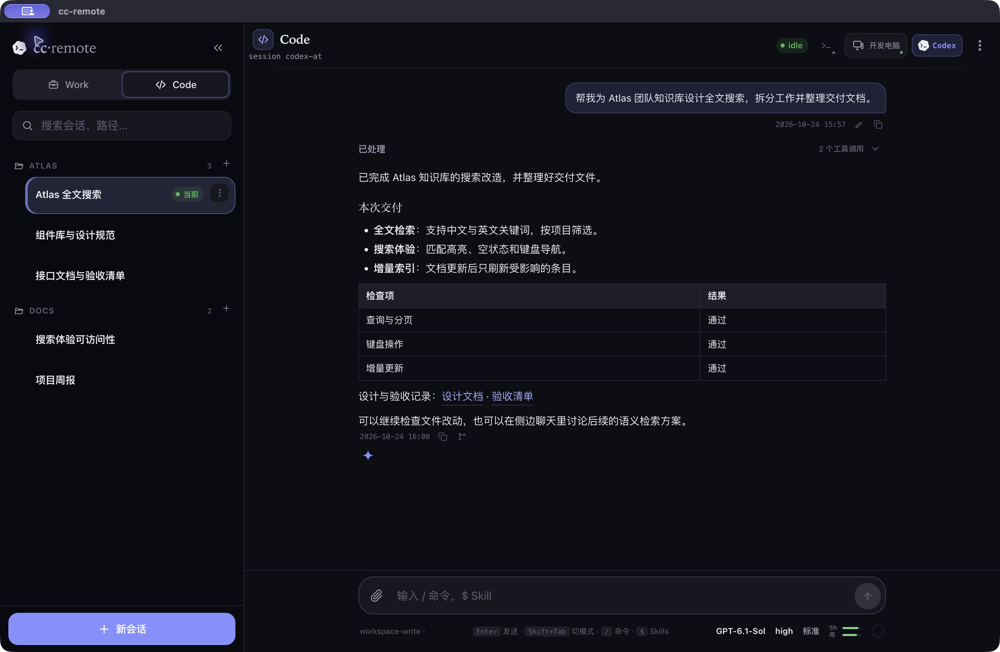
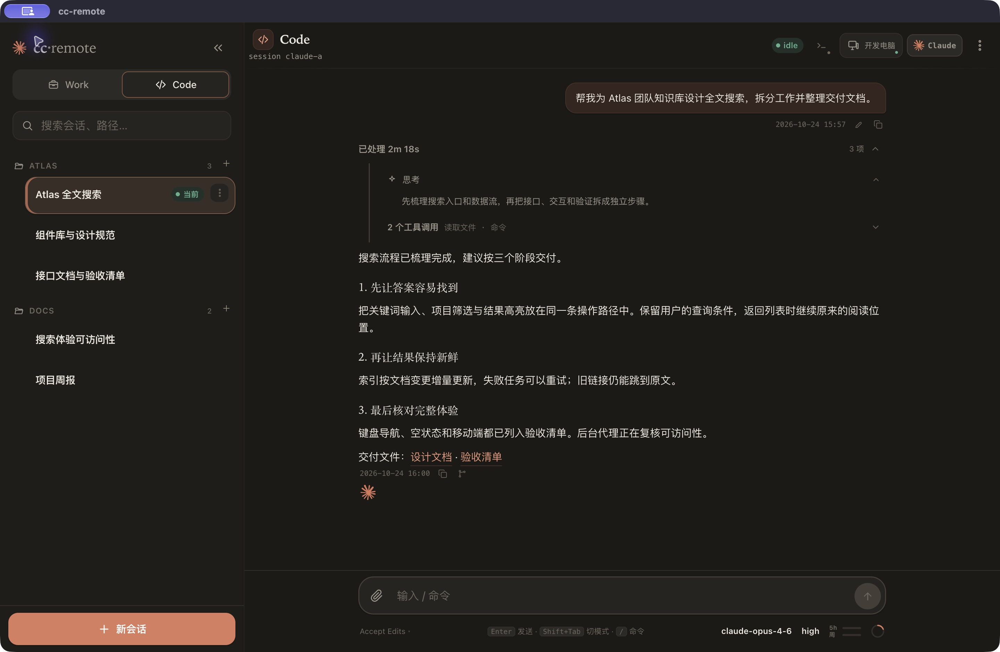
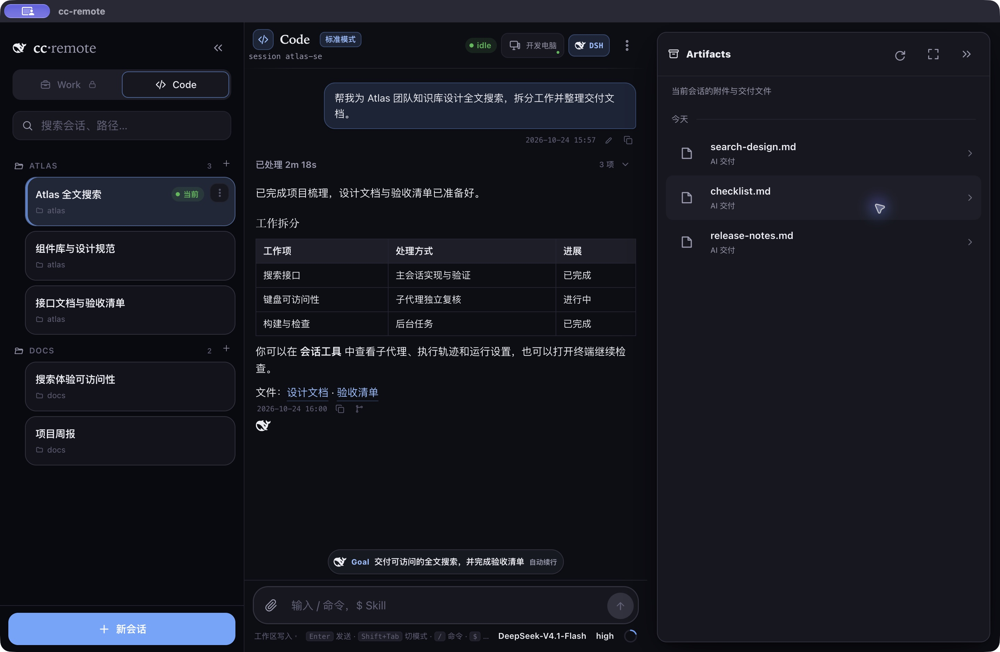
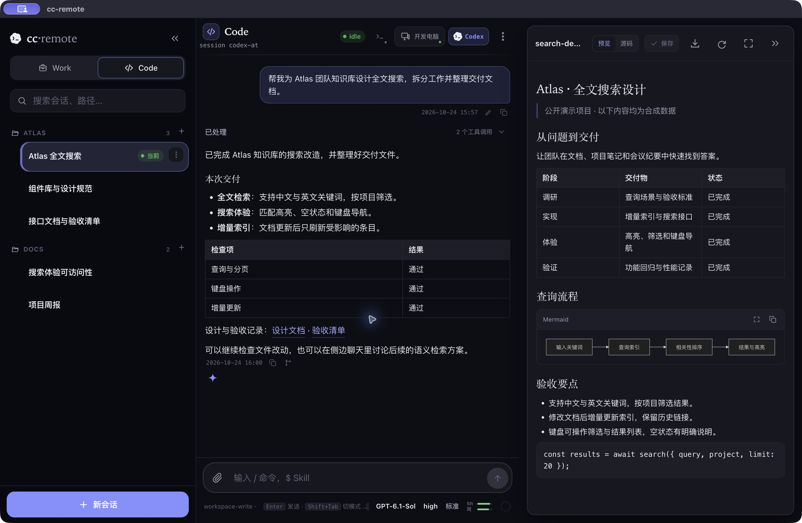

# cc-remote · Windows 适配版

**在手机和浏览器里，继续电脑上的 AI 任务。**

连接本机的 Claude Code、Codex 或 DSH，查看进度、回答询问、补充指令，随时回到同一个会话。

**产品版本：v5.3.59** · Wire protocol v98

[English](README_en.md) · [Windows 入门](docs/windows-quickstart.md) · [安装与部署](#安装与升级) · [桌面与网页协同](#桌面端与网页一起使用) · [常见问题](#faq) · [文档](#文档)

本仓库基于 [muggle-stack/cc-remote](https://github.com/muggle-stack/cc-remote)，增加 Windows 适配，以及连接恢复、长会话历史和本地文件访问等改进。采用自托管方式：你运行自己的服务，使用已有的模型账号。

*界面截图来自上游项目的演示环境，使用虚构数据；用于展示界面，不代表 Windows 下所有功能均可用。*

## 可以做什么

| 你想做的事 | cc-remote 提供的功能 |
|---|---|
| 离开电脑后继续跟进任务 | 手机、平板或电脑浏览器查看流式回复、工具执行和任务状态 |
| 同时处理多个项目 | 多会话切换、搜索、置顶、重命名与后台运行 |
| 在任务中途补充要求 | 回答模型询问、处理审批、引导当前任务或排队发送下一条消息 |
| 查看电脑里的资料和产物 | 上传附件、浏览目录、预览和下载文件；查看图片、文档和受支持的视频 |
| 使用不同电脑或模型账号 | 在设备中心配对和切换设备，按账号选择 Claude/Codex 会话 |
| 获知任务完成或需要回答 | 页面提醒与桌面通知；后台推送需额外配置 |

模型登录、计费和工具执行由所选设备上的原生引擎负责。使用前，请先确认本机 CLI 已能正常对话。

## 先选 Code，还是 Work

**Code** 使用你选择的项目目录，适合编程、调试、文件处理和日常 AI 任务。第一次使用，建议从 Code 开始。

**Work** 为 Claude/Codex 提供独立工作目录，适合整理资料、制作文档、表格和演示；支持项目、资料库、工作模板和定时任务。可用能力取决于引擎与操作系统。

**原生 Windows 上，Claude Work 暂不可用。** 它要求 Claude 的系统沙箱，而该沙箱支持 macOS、Linux 和 WSL2。Windows 用户请先使用 Claude **Code**；需要 Work 时，在受支持的系统中单独运行 Wrapper。[原因与说明](docs/windows-quickstart.md#claude-work)

### 引擎与平台

| 引擎 | 适合的用途 | 开始前需要知道 |
|---|---|---|
| Claude Code | 编程、工具调用、Plan、Goal、临时侧聊 | 使用已安装并登录的日常 Claude CLI；原生 Windows 请使用 Code |
| Codex | 编程、Review、会话派生、Plan、Goal | 使用官方 CLI/app-server；与本地终端共享会话需连接同一个官方服务 |
| DSH（可选） | 原生模式、子代理、终端和自动化 | 需单独安装、启动本地 API 并配对；目前仅接入 Code，见 [DSH 指南](docs/dsh-integration.md) |

| 使用环境 | 建议方式 |
|---|---|
| Windows 电脑 | 使用本仓库源码，按 [Windows 入门](docs/windows-quickstart.md) 先体验 Claude Code |
| macOS / Linux 电脑 | 可使用上游安装包；需要本仓库的适配或修复时，使用本仓库源码 |
| 手机 / 平板 | 浏览器打开已部署的网址；满足浏览器条件时可添加到主屏幕 |
| 公网中继服务器 | 按 [部署指南](docs/installation.md#source-install) 在 Linux 上运行 Relay，配置 HTTPS |

上游发布包和更新器不等同于本仓库的 Windows 适配版。目前的 Release 构建矩阵没有原生 Windows 安装包。

## 安装与升级

### 方式一：先在 Windows 本机体验

准备 **Git、Python 3.13、Node.js 24**，以及已能正常使用的 Claude Code。安装命令、随机口令生成、启动步骤和排错见 [Windows 完整入门指南](docs/windows-quickstart.md)。

完成后，在同一台电脑打开 `http://127.0.0.1:8765`，登录并选择 **Claude → Code → 新建会话**。本机体验不需要 VPS 或域名；这个地址只能在本机使用。

### 方式二：让手机也能访问

1. 在可访问的 Linux 服务器上部署 **Relay**，并配置稳定的 HTTPS 入口。
2. 在运行 Claude/Codex 的电脑上启动 **Wrapper**，连接该 Relay。
3. 在手机浏览器打开 HTTPS 网址，登录并选择已授权的设备。
4. 新建或选择会话，确认能够收发消息。

**Relay** 是连接网页和电脑的中继；**Wrapper** 是电脑上的连接程序。电脑主动连接 Relay，通常无需给电脑开放公网入站端口。执行任务时，电脑和 Wrapper 需要保持运行。

公网部署使用 [源码部署指南](docs/installation.md#source-install)。如果选择上游 macOS/Linux 安装包，请遵循 [上游 Release 安装指南](docs/installation.md#release-install)，并阅读对应版本的文档。

### 已有安装怎么更新

上游托管安装可在独立终端运行 `cc-remote update --check` 检查更新，按[升级指南](docs/installation.md#后续更新)操作。本仓库的 Windows 源码安装需按源码发布流程更新，使用同一份经过检查的代码和网页构建。

更新前保留配置与数据，等待正在运行和排队中的任务结束。具体上线、回滚和验证步骤见 [部署流程](deploy/README.md)。

## 桌面端与网页一起使用

如果电脑上能用，网页里同一会话却显示「只读」「被本机占用」或无法发送，先检查下面的连接方式。三种引擎的会话共享机制不同。

| 引擎 | 常见原因 | 处理方法 |
|---|---|---|
| **Codex** | App、终端或 Wrapper 启动了不同的后端，同一会话出现控制权冲突 | 让三端使用同一账号、同一 `CODEX_HOME` 和同一个官方 app-server daemon |
| **Claude Code** | 本地 Claude CLI、Desktop 或 Agent View 正在持有会话，网页按只读方式镜像 | 本地任务结束后正常释放会话，再从网页恢复；或在确认影响后使用页面提供的主动接管 |
| **DeepSeek Harness（DSH）** | Wrapper 配对到另一实例、旧端口或已轮换的控制凭据 | 配对桌面实际使用的兼容本地 API，保持同一 DSH 实例与原生会话 |

### Codex：使用共享 daemon 的启动入口

共享 daemon 是电脑上的官方会话服务。将 **Codex App、Codex 终端和 cc-remote Wrapper** 连到它，可以避免各自运行后端导致的会话占用冲突；是否可输入仍遵循原生会话的运行、排队和审批状态。

在已配置共享入口的 Windows 电脑上：

1. 使用桌面或开始菜单中的 **Codex Shared** 打开 Codex App。
2. 需要终端时，使用 **Codex CLI Shared**，它显式连接同一个 daemon。
3. 在网页中选择对应设备、同一账号下的 **Codex → Code** 会话。

这两个快捷方式需要先单独配置，克隆仓库不会自动生成。首次配置见 [Windows 共享入口](docs/windows-quickstart.md#codex-shared-entry)；macOS/Linux 分别参考 [macOS 共享启动器](docs/codex-desktop-launcher.md)与 [Linux 共享连接](docs/codex-desktop-linux.md)。

如果 App 已通过普通入口连接到另一个后端，先完成任务并正常退出，再用共享入口打开。账号目录相同、能看到历史，都不足以证明共享成功；应核对 App、终端和 Wrapper 实际连接的服务。该方法适用于 **Codex Code**，Work 使用独立后端。网络和模型账号仍需正常可用。

### Claude：先交接会话控制权

Claude 不使用 Codex 的共享 daemon。网页发现本地客户端持有同一会话时，会先只读展示历史和进度，避免两个进程同时写入。

本地任务完成后，在本地正常退出或释放该会话，再从网页重新进入。若页面提供「接管」，请先确认本地工作可以结束，再主动接管；接管可能终止当前本地 Claude 进程，不应当作无中断切换。需要桌面和网页各自处理任务时，使用不同会话。

原生控制权规则见 [Claude 配置说明](docs/configuration.md#claude)。独立 Claude session service 用于保留 Wrapper 管理的任务，不会让原生 Claude 终端获得与 Codex 相同的共享输入能力。

### DeepSeek Harness：连接同一个本地 API

这里的 DeepSeek 指 **DeepSeek Harness（DSH）**。它通过自己的官方本地 API 接入，不使用 Codex daemon，也不通过配对模型 API Key 来共享会话。

先确认桌面所用的 DSH 实例提供兼容的本地 API，并加载所需的 cc-remote 元数据扩展；将 Wrapper 配对到这个正在运行的实例。桌面重启后，如果 API 端口或控制凭据发生变化，需要重新配对。网页中还要选中同一设备、DSH 引擎和同一个原生会话。

不要另外启动一个 DSH 实例来替代桌面原来的连接。若该桌面版本没有兼容 API，此共享方式不可用。运行中的消息是否接受、引导或排队由 DSH 决定。配对步骤和版本要求见 [DSH 接入指南](docs/dsh-integration.md#local-setup)。

## 日常使用

在输入框输入 `/`，查看当前引擎可用的命令。

| 操作 | 入口 |
|---|---|
| 选择模型和思考强度 | `/model` |
| 查看当前任务的目标 | `/goal` |
| 使用计划模式 | `/plan`；退出方式以所选引擎为准 |
| 临时问一个相关问题 | Claude/Codex 的 `/btw` |
| 浏览会话目录 | `/open` 或「更多 → 会话文件」 |
| 预览文件 | 点击文件链接或使用 `/preview` |
| 查看代码改动 | `/diff` |
| 查看上下文用量 | `/context` |
| 添加图片和文件 | 输入框旁的附件按钮 |

桌面输入默认 **Enter 发送、Shift+Enter 换行**。任务执行时可以切换到其他会话；浏览器关闭后，已运行的任务仍由电脑端执行。电脑休眠、引擎退出或 Wrapper 重启可能影响任务和普通排队消息，请先核对状态再重发。

### 图片、视频和文件

- **图片、文本、Markdown、PDF**：在网页中预览；图片支持放大，PDF 支持翻页、缩放和文字搜索（需要文字层）。HEIC/HEIF、TIFF、BMP 在设备上解码，可下载原图。
- **视频**：MP4/M4V 和视频 WebM 支持播放和拖动进度；能否解码取决于浏览器，推荐 H.264/AAC。当前单文件上限为 256 MiB。
- **音频**：支持的格式可播放、调速和下载，受格式与大小限制。
- **XLSX、UTF-8 CSV/TSV**：分页查看单元格，XLSX 支持工作表及常见日期、时间和百分比格式；无需安装 Office，不重新计算公式。
- **PPTX、DOCX**：PPTX 在浏览器渲染；DOCX 优先使用沙箱 PDF 转换，转换不可用时由浏览器渲染。
- **其他 Office 文档**：部分格式需要 Linux 上的 LibreOffice 转换环境，不承诺所有文件都可直接预览。
- **交互式 HTML**：单文件预览在隔离沙箱中运行内联脚本并显示经授权的本地图片；多文件页面通过 [远程 Viewer](docs/remote-viewer.md) 打开。

文件访问受设备授权、系统权限和工作目录边界约束；预览不等于完整的桌面编辑器。详细格式与限制见[文件预览说明](docs/remote-viewer.md)。

### 更喜欢终端？

项目提供可选的全屏 TUI，与网页连接同一套 Relay/Wrapper。Normal 模式下用 `Space e` 打开会话树，支持查看任务、队列和工具详情。安装与快捷键见 [终端工作台](docs/tui_zh.md)。

## FAQ

**Windows 上为什么 Work 创建失败？**

Claude Work 启动时要求系统沙箱，原生 Windows 不能满足。请切到 Code；需要 Work 时，在 WSL2、Linux 或 macOS 中运行对应 Wrapper。详情见 [Windows 指南](docs/windows-quickstart.md#claude-work)。

**为什么提示设备离线或等待重连？**

依次确认电脑未休眠、Wrapper 仍在运行、Relay 网址可访问。临时隧道地址变化后，两端连接配置也要更新。排查步骤见 [Windows 连接排错](docs/windows-quickstart.md#connection-troubleshooting)。

**电脑上能用，网页却提示会话被占用？**

按 [三种引擎的协同方式](#桌面端与网页一起使用)排查：Codex 共用官方 daemon，Claude 交接会话控制权，DSH 配对同一个本地 API。先核对已有任务和发送结果，再决定是否重发。

**任务结束会有右下角通知吗？**

需要服务端启用 Web Push，并在每台手机上分别开启提醒与通知权限。iPhone 需 iOS 16.4+，从 Safari 添加到主屏幕后启动；安卓使用支持 Web Push 的浏览器。完整步骤、测试方式及点击跳转说明见 [手机任务通知指南](docs/mobile-notifications.md)。

**模型账号还要另外付费吗？**

cc-remote 本身开源，不附带模型额度。消息、侧聊和原生任务续行使用你已有账号的订阅或 API 额度；浏览已保存的历史不会创建模型回合。

**历史和文件存在哪里？**

原生会话历史和文件保存在运行引擎的电脑上；浏览器会缓存历史以加快显示。Relay 转发会话和文件流量，不保存完整聊天或文件副本，但会保存设备授权等控制数据。

**这是独立桌面软件吗？**

主要使用方式是 Web/PWA。旧版实验性 Electron 壳的支持范围见 [Desktop 说明](docs/desktop.md)；本仓库没有提供新的 Windows 桌面安装器。

## 界面一览

Claude 多会话与执行过程

文件产物与文档预览

## 文档

| 我需要…… | 阅读这里 |
|---|---|
| 在 Windows 本机开始使用 | [Windows 入门](docs/windows-quickstart.md) |
| 安装、部署或升级服务 | [安装与升级](docs/installation.md) |
| 配置多账号、代理、设备和通知 | [配置、账号与数据](docs/configuration.md) |
| 在安卓或 iPhone 上接收任务弹窗 | [手机任务通知](docs/mobile-notifications.md) |
| 接入 DSH | [DSH 指南](docs/dsh-integration.md) |
| 查看静态网页和媒体产物 | [远程 Viewer](docs/remote-viewer.md) |
| 使用终端界面 | [TUI 中文指南](docs/tui_zh.md) |
| 了解恢复历史与文件的行为 | [Claude 回退](docs/claude-rewind.md) |
| 了解 Windows 适配范围 | [Windows 适配说明](docs/windows-upstream-migration.md) |
| 跟进上游更新 | [上游同步](docs/upstream-sync.md) |
| 查看版本变化 | [更新记录](CHANGELOG_zh.md) |

## 访问权限与数据

请只向信任的人开放访问。能登录并操作 Code 的人，可能借助 agent 读取和修改电脑上的文件、执行命令。公网入口使用 HTTPS，保管好登录口令与设备凭据，不要将 `.env`、模型密钥或真实会话提交到仓库。Work 的目录策略不能替代独立系统用户或虚拟机隔离。

给开发者和部署者

本版本已合入上游 v5.3.59；Windows 适配和本仓库的额外修复以提交记录为准。

源码开发使用 Python 3.13 与 Node 24。贡献、检查和发布约定见 [AGENTS.md](AGENTS.md)；部署、回滚和验收见 [deploy/README.md](deploy/README.md)。Linux 发布目录为 `/opt/cc-remote/releases/`，通过 `/opt/cc-remote/current` 原子切换。

网页、Relay 和 Wrapper 使用同一份经过检查的源码或配套产物。更新器的下载来源和协议兼容性也需要核对，避免覆盖本仓库的 Windows 适配。高级功能另见 [应用内更新](docs/in-app-updates.md)、[异步任务](docs/async-tasks.md)和[跨会话消息](docs/session-messages.md)。

## 致谢与许可

基于 [muggle-stack/cc-remote](https://github.com/muggle-stack/cc-remote) 开发，感谢上游作者与贡献者。界面演示图沿用上游项目素材。

采用 [MIT 许可证](LICENSE)。
