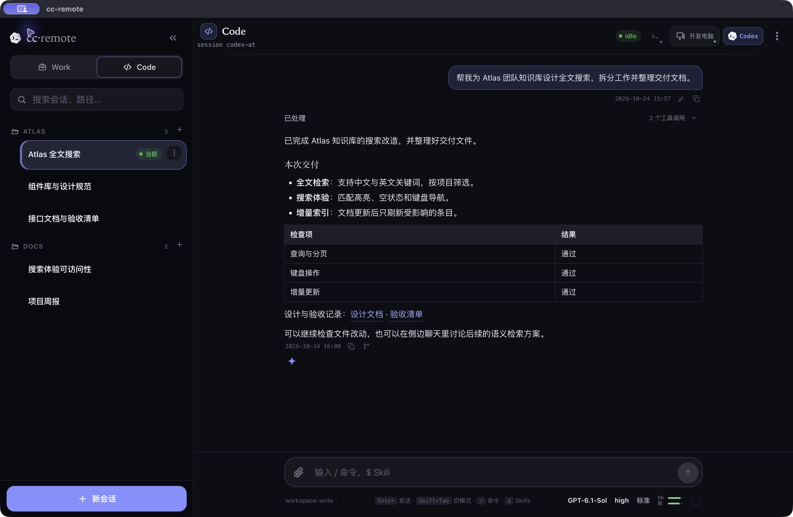
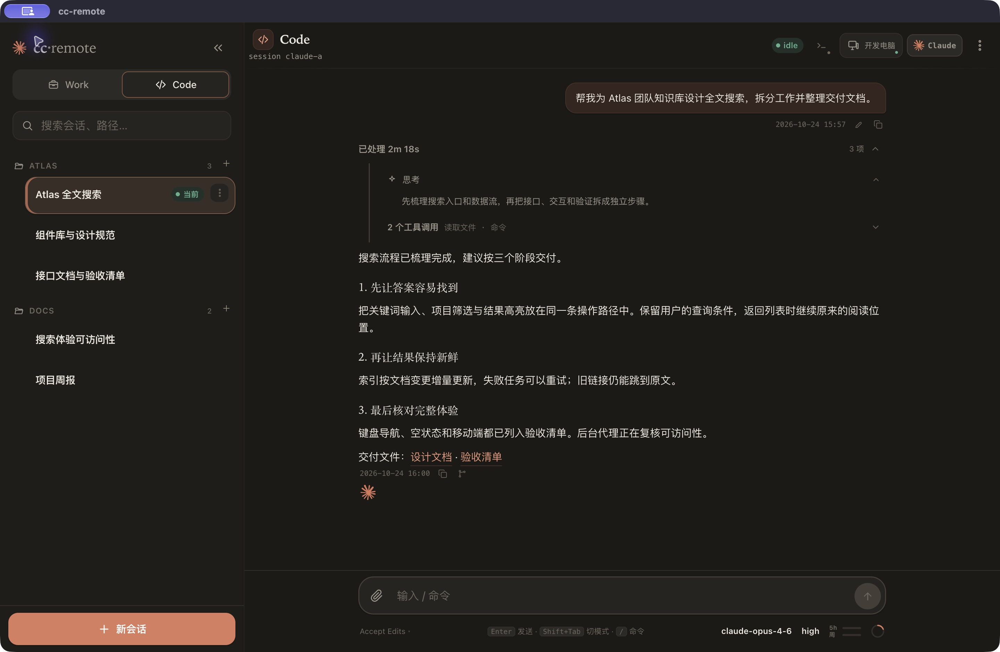
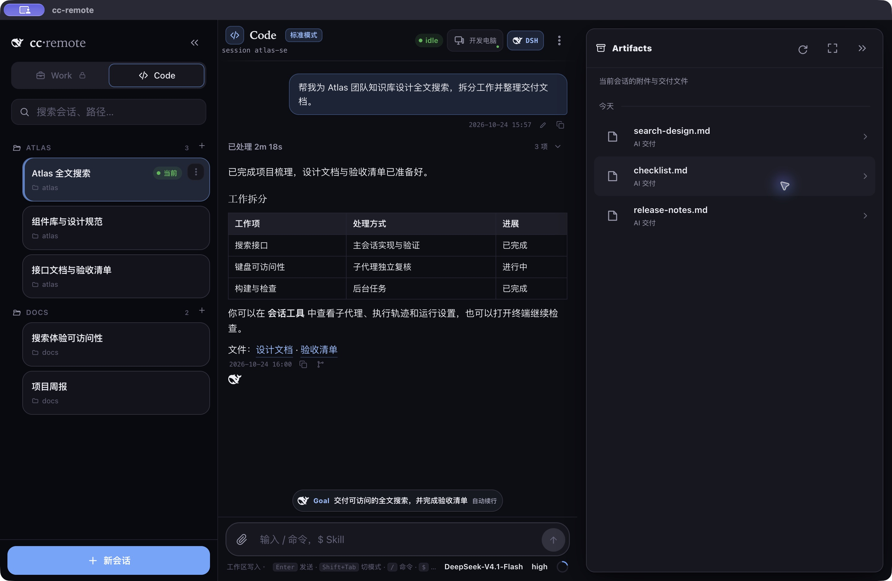
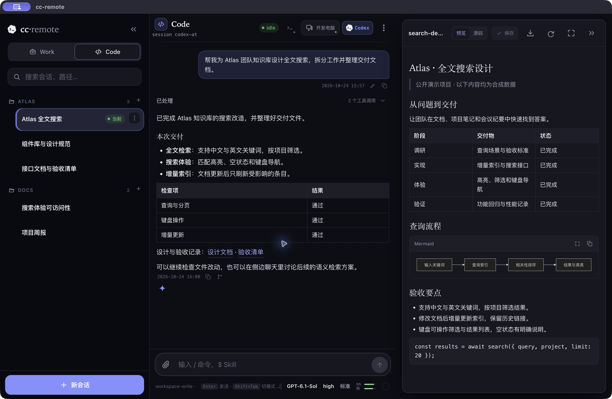

# cc-remote · Windows adaptation

**Continue your computer's AI tasks from a phone or browser.**

Connect to Claude Code, Codex or DSH on your machine. Follow progress, answer questions and add instructions without leaving the conversation.

[中文](README.md) · [Windows quick start](docs/windows-quickstart_en.md) · [Installation](#install-and-upgrade) · [FAQ](#faq) · [Documentation](#documentation)

This fork of [muggle-stack/cc-remote](https://github.com/muggle-stack/cc-remote) adds Windows compatibility and improvements to reconnects, long conversation history and local file access. It is self-hosted: you run the service and use your existing model accounts.

*Screenshots come from the upstream demonstration environment and use fictional data. They illustrate the interface; they do not establish that every feature works on Windows.*

## What you can do

| What you need | What cc-remote provides |
|---|---|
| Follow a task away from your desk | Streaming replies, tool activity and task status in a phone, tablet or computer browser |
| Work across several projects | Multiple sessions, search, pins, renaming and background execution |
| Add instructions while a task runs | Answer questions, handle approvals, steer supported tasks or queue the next message |
| Access files and deliverables | Upload attachments, browse directories, preview and download files, including supported images, documents and videos |
| Use several computers or accounts | Pair and select devices, with separate Claude/Codex account profiles |
| Know when a task finishes or needs an answer | Page alerts and desktop notifications; background push requires additional setup |

Model sign-in, billing and tool execution belong to the native engine on the selected device. Confirm that its CLI can hold a conversation before connecting it to cc-remote.

## Choose Code or Work

**Code** operates in a project directory you select. Use it for development, debugging, file tasks and everyday agent work. It is the recommended starting point.

**Work** provides separate Claude/Codex working directories for research, documents, spreadsheets and presentations. It includes projects, source libraries, templates and schedules. Availability depends on the engine and operating system.

**Claude Work is currently unavailable on native Windows.** It requires Claude's OS sandbox, which supports macOS, Linux and WSL2. Windows users should start with Claude **Code**. To use Work, run a separate Wrapper in a supported environment. [Details](docs/windows-quickstart_en.md#claude-work)

### Engines and platforms

| Engine | Useful for | Before you start |
|---|---|---|
| Claude Code | Coding, tools, Plan, Goal and side conversations | Uses your installed, signed-in daily Claude CLI; use Code on native Windows |
| Codex | Coding, Review, forks, Plan and Goal | Uses the official CLI/app-server; sharing with a local terminal requires the same official server |
| DSH (optional) | Native modes, subagents, terminals and automation | Separate installation, local API and pairing required; currently Code only. See the [DSH guide](docs/dsh-integration.md) |

| Environment | Recommended path |
|---|---|
| Windows computer | Use this fork's source and the [Windows quick start](docs/windows-quickstart_en.md) to try Claude Code |
| macOS / Linux computer | Upstream packages are available; use this fork's source when you need its adaptations or fixes |
| Phone / tablet | Open your deployed site in a browser; add it to the home screen where supported |
| Public relay server | Run Relay on Linux with HTTPS, following the [deployment guide](docs/installation_en.md#source-install) |

Upstream packages and their updater are separate from this fork's Windows source. The current Release build matrix does not include a native Windows installer.

## Install and upgrade

### Option 1: try it locally on Windows

Prepare **Git, Python 3.13, Node.js 24** and a working Claude Code installation. The [complete Windows guide](docs/windows-quickstart_en.md) covers installation, generated login credentials, startup and troubleshooting.

After setup, open `http://127.0.0.1:8765` on the same computer, sign in and choose **Claude → Code → New session**. This local setup needs no VPS or domain. The address is accessible only from that computer.

### Option 2: connect from your phone

1. Deploy **Relay** on a reachable Linux server with a stable HTTPS address.
2. Run **Wrapper** on the computer with Claude/Codex and connect it to Relay.
3. Open the HTTPS site on your phone, sign in and select an authorized device.
4. Open or create a session and confirm that messages work.

**Relay** connects the browser to your computer; **Wrapper** is the connection program running on that computer. Wrapper makes an outbound connection, so your computer usually needs no public inbound port. Keep the computer awake and Wrapper running while tasks execute.

For public access, follow the [source deployment guide](docs/installation_en.md#source-install). If you choose upstream macOS/Linux packages, follow the [upstream Release guide](docs/installation_en.md#release-install) and the documentation for that version.

### Updating an existing installation

Upstream managed installations can run `cc-remote update --check` from an independent terminal and follow the [upgrade guide](docs/installation_en.md#subsequent-updates). Windows source installations of this fork use the source release procedure, with matching checked code and Web assets.

Preserve configuration and data, and let running and queued tasks finish before switching. See the [deployment procedure](deploy/README.md) for activation, rollback and acceptance.

## Everyday use

Type `/` in the composer to see commands available for the selected engine.

| Action | Entry point |
|---|---|
| Choose a model and reasoning level | `/model` |
| View the task objective | `/goal` |
| Use planning mode | `/plan`; exit behavior depends on the engine |
| Ask a related question on the side | `/btw` in Claude/Codex |
| Browse the session directory | `/open` or the session files menu |
| Preview a file | Click its link or use `/preview` |
| Inspect code changes | `/diff` |
| View context usage | `/context` |
| Attach images and files | The attachment button beside the composer |

On desktop, **Enter sends and Shift+Enter inserts a newline**. You can switch sessions while tasks run. Tasks already running continue on the computer when the browser closes. Sleep, engine exits or Wrapper restarts can affect tasks and ordinary queued messages; check their status before resending.

### Images, videos and files

- **Images, text, Markdown and PDF:** preview in the browser; enlarge images for a closer look.
- **Video:** play and seek MP4/M4V files. Decoding depends on the browser; H.264/AAC is recommended. The current per-file limit is 256 MiB.
- **Audio:** play, change speed and download supported formats, subject to format and size limits.
- **XLSX:** read worksheets and saved cell values without Office; formulas are not recalculated.
- **Other Office documents:** some formats require LibreOffice conversion on Linux. Direct previews are not available for every file.
- **Interactive HTML:** use [Remote Viewer](docs/remote-viewer.md) for authorized static pages and their resources.

Access follows device authorization, OS permissions and workspace boundaries. Previewing a file does not provide a full desktop editor. See the [preview documentation](docs/remote-viewer.md) for details.

### Prefer a terminal?

An optional full-screen TUI connects to the same Relay and Wrapper as Web. Use `Space e` in Normal mode to open the session tree and inspect tasks, queues and tool activity. See the [terminal workspace guide](docs/tui.md) for setup and shortcuts.

## FAQ

**Why does creating Work fail on Windows?**

Claude Work requires an OS sandbox that native Windows cannot provide. Select Code, or run the corresponding Wrapper in WSL2, Linux or macOS for Work. See the [Windows guide](docs/windows-quickstart_en.md#claude-work).

**Why does the device show as offline or reconnecting?**

Check that the computer is awake, Wrapper is running and the Relay address is reachable. If a temporary tunnel address changes, the connection configuration must change too. See [connection troubleshooting](docs/windows-quickstart_en.md#connection-troubleshooting).

**Will a notification appear when a task finishes?**

Enable Web Push on the server and enable alerts and notification permission separately on each phone. On iPhone, use iOS 16.4+ and launch the site after adding it to the home screen with Safari. On Android, use a browser supporting Web Push. See the [phone notification guide](docs/mobile-notifications_en.md) for setup, delivery checks and click navigation.

**Do I need a paid model account?**

cc-remote is open source and includes no model allowance. Messages, side conversations and native task continuation use your existing subscription or API quota. Reading saved history does not create a model turn.

**Where are history and files stored?**

Native history and files stay on the engine's computer. Browsers cache history for faster display. Relay forwards conversation and file traffic without storing full chats or file copies, but it does store control data such as device authorization.

**Is this a standalone desktop app?**

Web/PWA is the main interface. See [Desktop compatibility](docs/desktop.md) for the older experimental Electron shell. This fork does not provide a new Windows desktop installer.

## Interface preview

Claude sessions and activity

Deliverables and document previews

## Documentation

| I want to… | Read |
|---|---|
| Start locally on Windows | [Windows quick start](docs/windows-quickstart_en.md) |
| Install, deploy or upgrade | [Installation and upgrades](docs/installation_en.md) |
| Set up accounts, proxies, devices and notifications | [Configuration, accounts and data](docs/configuration_en.md) |
| Receive task alerts on Android or iPhone | [Phone notifications](docs/mobile-notifications_en.md) |
| Connect DSH | [DSH guide](docs/dsh-integration.md) |
| Open static pages and media | [Remote Viewer](docs/remote-viewer.md) |
| Use a terminal interface | [TUI guide](docs/tui.md) |
| Understand history and file recovery | [Claude rewind](docs/claude-rewind.md) |
| Understand Windows compatibility | [Windows adaptation notes](docs/windows-upstream-migration.md) |
| Read version changes | [Changelog](CHANGELOG.md) |

## Access and data

Share access only with people you trust. Someone who can sign in and operate Code may use the agent to read or change files and run commands on your computer. Use HTTPS publicly, protect login and device credentials, and keep `.env`, model keys and real conversations out of Git. Work's directory policy is not a substitute for separate OS users or virtual machines.

For developers and operators

**Product version: v5.3.52** · Wire protocol v97. This version follows the upstream baseline; consult the commit history for this fork's additional fixes.

Source development uses Python 3.13 and Node 24. See [AGENTS.md](AGENTS.md) for contributions and checks, and [deploy/README.md](deploy/README.md) for deployment, rollback and acceptance. Linux releases live under `/opt/cc-remote/releases/` and switch atomically through `/opt/cc-remote/current`.

Web, Relay and Wrapper should use the same checked source snapshot or coordinated artifacts. Verify the updater's download source and protocol compatibility so that an update preserves this fork's Windows adaptations. Advanced features include [in-app updates](docs/in-app-updates.md), [async tasks](docs/async-tasks.md) and [cross-session messages](docs/session-messages.md).

## Credits and license

Based on [muggle-stack/cc-remote](https://github.com/muggle-stack/cc-remote). Thanks to the upstream author and contributors. Interface screenshots use upstream demonstration assets.

Licensed under [MIT](LICENSE).
